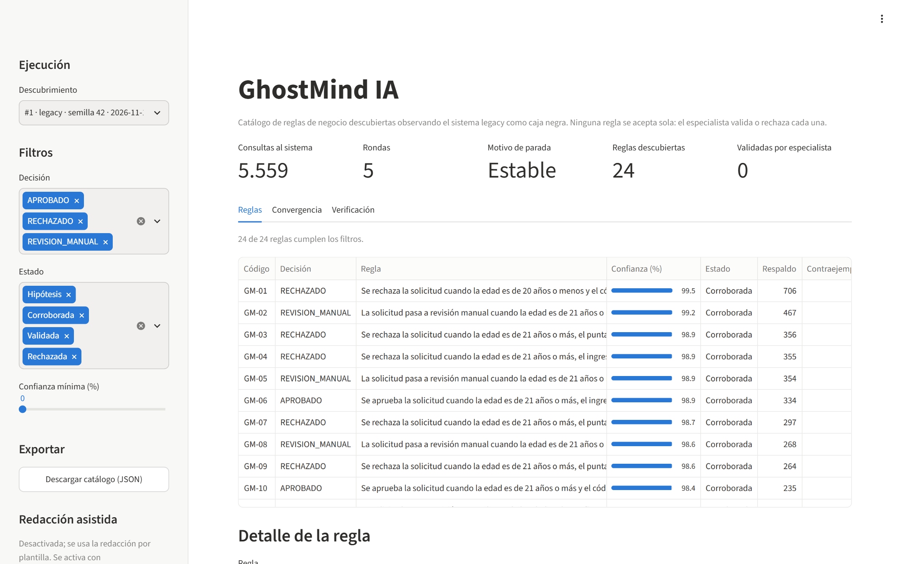
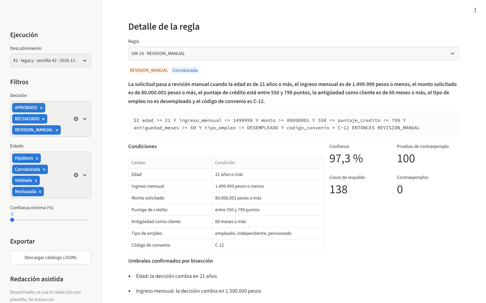
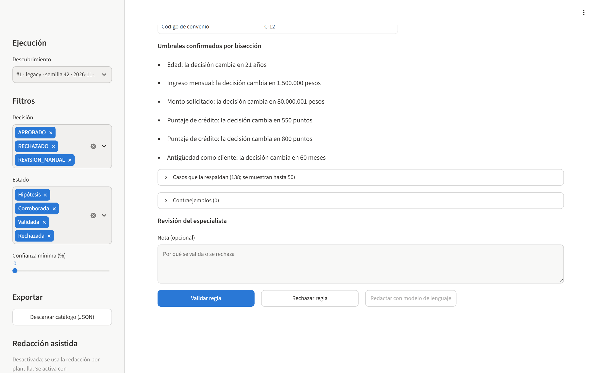
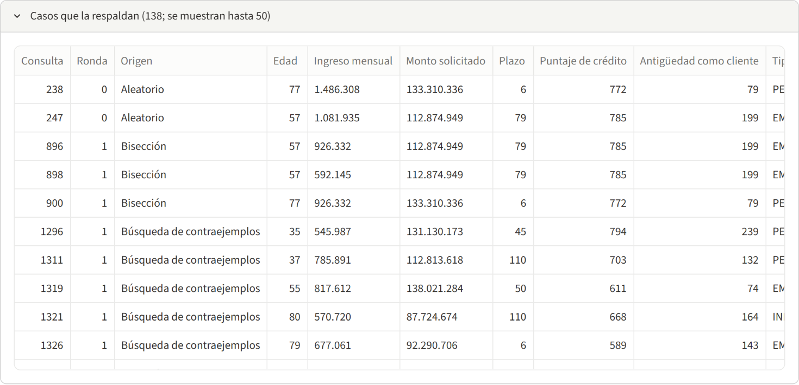
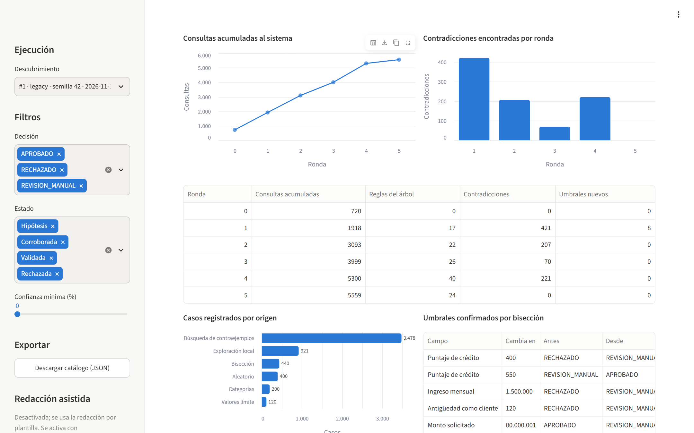
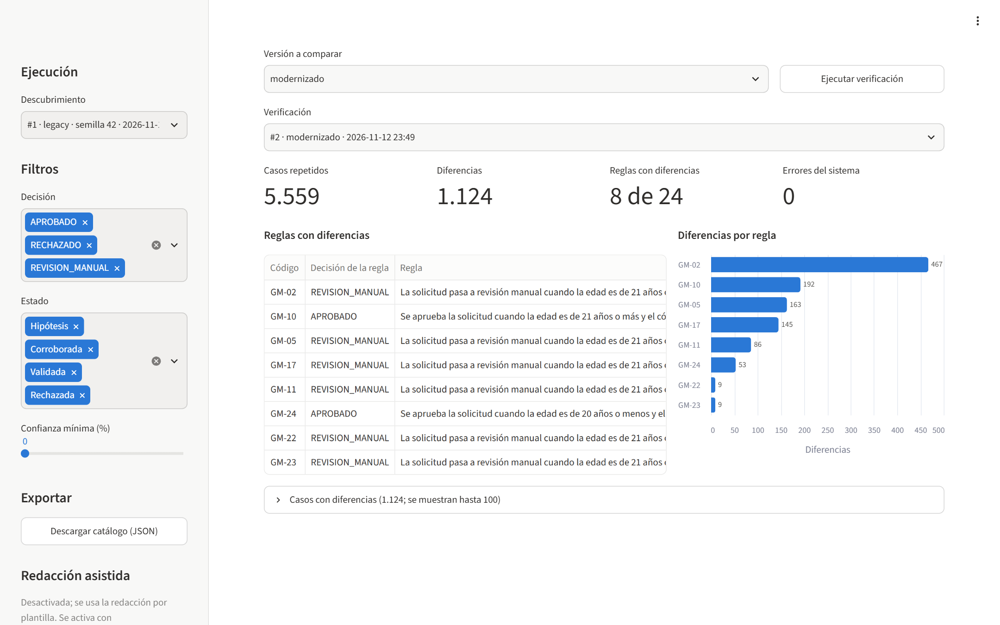

# GhostMind IA: prototipo (MVP)

GhostMind IA descubre las reglas de negocio ocultas en un sistema legacy observando solo su
comportamiento, como una caja negra. Cada regla queda con su evidencia y un nivel de confianza para
que un especialista la valide antes de modernizar el sistema; después, los casos registrados sirven
para verificar que la versión modernizada conserva esas reglas.

Este repositorio contiene la prueba de concepto del proyecto de la asignatura Gestión de Tecnología e
Innovación (Universidad El Bosque, semestre 2026-2). Para controlar el alcance se usa un escenario
pequeño y medible: un módulo legacy **simulado** de aprobación de créditos con 10 reglas plantadas que
solo conoce el equipo, de modo que lo que GhostMind descubre puede compararse con la verdad.

## Resultados del experimento

Generados por ejecución real con `python -m evaluacion.experimento` (semilla 42, presupuesto de
20.000 consultas). El detalle completo está en [resultados/metricas.md](resultados/metricas.md) y la
repetición con otras cinco semillas en [resultados/robustez.md](resultados/robustez.md).

| Criterio (meta fijada antes de las pruebas) | Resultado |
|---|---|
| C1. Cobertura: al menos 80 % de las reglas plantadas | 90,0 % (9 de 10) |
| C2. Precisión: al menos 90 % de las reglas reportadas existen | 100,0 % (24 de 24) |
| C3. Fidelidad: al menos 95 % en 10.000 casos nuevos | 99,9 % (9.992 de 10.000) |
| C4. Utilidad para especialistas | Pendiente: se mide con usuarios ([instrumento](evaluacion/instrumento_c4/cuestionario.md)) |
| C5. Detección de reglas alteradas: 100 % | 100,0 % (3 de 3) |
| Consultas al sistema en el descubrimiento | 5.559 de 20.000 (5 rondas) |

La regla no recuperada es la excepción muy poco frecuente que se plantó a propósito (afecta al
0,066 % de las solicitudes posibles). Con la semilla 42 no apareció; con la semilla 3 sí (ver
robustez). Es el límite principal del método y queda documentado como tal.

## Cómo funciona

```text
 sistemas/diccionario_credito.json   (lo único que GhostMind sabe del sistema)
                │
 explorador ──► adaptador ──► sistema legacy (legacy/crdapr01.py, caja negra)
     ▲              │
     │              ▼
 extractor ◄── registro SQLite (cada consulta, su ronda y su origen)
 (árbol de decisión → reglas con evidencia, confianza y estado)
     │
     ▼
 catálogo Streamlit (el especialista valida o rechaza) ──► exportación JSON
     │
 verificador ──► adaptador ──► versión modernizada (legacy/crdapr_moderno.py)

 evaluacion/  (fuera de GhostMind: único lector de las reglas verdaderas; calcula C1 a C5)
```

1. **Muestreo inicial**: 720 solicitudes entre aleatorias, valores límite de cada campo y todas las
   combinaciones de categorías.
2. **Rondas dirigidas**: un árbol de decisión induce reglas; para cada umbral, GhostMind varía un solo
   campo y divide el intervalo por mitades hasta encontrar el valor exacto donde cambia la decisión;
   prueba cada regla buscando contraejemplos y explora alrededor de los que encuentra.
3. **Parada**: cuando una ronda no encuentra contradicciones ni umbrales nuevos, al agotar el
   presupuesto o al llegar a 15 rondas.
4. **Reglas**: cada hoja del árbol es una regla con sus casos de respaldo, contraejemplos, confianza
   (límite inferior de Wilson al 95 %) y estado (`hipótesis` o `corroborada`; `validada` y `rechazada`
   solo las asigna el especialista).

## Requisitos e instalación

Python 3.11 o superior y git.

```bash
git clone https://github.com/judricalderon/Ghostmind.git
```

```bash
cd Ghostmind
```

```bash
python -m venv .venv
```

En Windows (PowerShell):

```bash
.venv\Scripts\Activate.ps1
```

En Linux o macOS:

```bash
source .venv/bin/activate
```

```bash
pip install -r requirements.txt
```

Opcionales: `requirements-capturas.txt` (capturas con Microsoft Edge) y `requirements-llm.txt`
(redacción con modelo de lenguaje).

## Ejecutar el prototipo

Todas las órdenes se ejecutan desde la raíz del repositorio con el entorno virtual activo.

**1. Pruebas automáticas** (incluyen la prueba de caja negra que impide que GhostMind lea el código del
legacy o las reglas verdaderas):

```bash
python -m pytest
```

**2. Descubrir las reglas del legacy**:

```bash
python -m ghostmind descubrir --objetivo legacy --semilla 42 --presupuesto 20000
```

La evidencia queda en `datos/ghostmind.sqlite` (se cambia con `--db` o la variable `GHOSTMIND_DB`).
Para volver a ver las reglas de una ejecución: `python -m ghostmind reglas --ejecucion 1`.

**3. Abrir el catálogo para el especialista**:

```bash
streamlit run app/catalogo.py
```

Muestra las reglas con su redacción de negocio, condiciones, umbrales confirmados, confianza, estado y
evidencia; permite validar o rechazar cada regla con una nota y descargar el catálogo en JSON. Las
pestañas Convergencia y Verificación muestran cómo avanzó el descubrimiento y el resultado de la
verificación. Se puede abrir directo una ejecución y una regla con `?ejecucion=1&regla=GM-05`.

**4. Verificar la versión modernizada**:

```bash
python -m ghostmind verificar --ejecucion 1 --objetivo modernizado
```

Con `--objetivo legacy` sirve de control: debe dar cero diferencias.

**5. Exportar el catálogo**:

```bash
python -m ghostmind exportar --ejecucion 1 --salida catalogo.json
```

**6. Reproducir el experimento completo** (menos de un minuto; reescribe `resultados/`):

```bash
python -m evaluacion.experimento
```

**7. Regenerar las capturas del catálogo** (requiere Microsoft Edge y `pip install -r requirements-capturas.txt`):

```bash
python -m evaluacion.capturas
```

**8. Calificar el instrumento de C4** después de aplicarlo a los participantes:

```bash
python -m evaluacion.instrumento_c4.puntuar respuestas.csv
```

### Redacción con modelo de lenguaje (opcional, desactivada por defecto)

GhostMind puede pedir a Claude (`claude-opus-5-5`) una redacción más natural de cada regla. Nunca
cambia condiciones ni decisiones y ninguna métrica depende de ella: si la redacción menciona valores
que no están en la regla o cambia la decisión, se descarta y queda la redacción por plantilla. Para
activarla, instalar `requirements-llm.txt` y definir las variables de entorno `GHOSTMIND_LLM=1` y
`ANTHROPIC_API_KEY` (la llave nunca se guarda en el repositorio). `GHOSTMIND_LLM_MODELO` cambia el modelo.

## Demostración sin ejecutar nada

Capturas generadas con `python -m evaluacion.capturas` sobre la ejecución real de la semilla 42:

| Catálogo de reglas | Detalle de una regla |
|---|---|
|  |  |
| **Revisión del especialista** | **Evidencia de la regla** |
|  |  |
| **Convergencia del descubrimiento** | **Verificación de la versión modernizada** |
|  |  |

Para un video, el guion está en [docs/guion_video.md](docs/guion_video.md).

## Estructura del repositorio

| Carpeta | Contenido |
|---------|-----------|
| `sistemas/` | Diccionario de campos y puntos de entrada: lo único que GhostMind conoce del sistema |
| `legacy/` | Sistema legacy simulado y su versión modernizada (GhostMind no los lee) |
| `ghostmind/` | El producto: diccionario, adaptador, registro SQLite, muestreo, extractor, explorador, catálogo, redacción opcional y verificador |
| `app/` | Interfaz del catálogo en Streamlit |
| `evaluacion/` | Reglas verdaderas, alteraciones, métricas, experimento, capturas e instrumento de C4 (fuera de GhostMind) |
| `resultados/` | Métricas, robustez, catálogo exportado y capturas, generados por ejecución real |
| `specs/001-ghostmind-mvp/` | Especificación, plan, decisiones de diseño, modelo de datos, contratos y tareas |
| `.specify/` | Constitución del proyecto y plantillas de Spec Kit |
| `tests/` | Pruebas automáticas |
| `docs/` | Guion de demostración |

## Proceso de desarrollo

El prototipo se construyó por fases (0 a 7) con un proceso dirigido por especificaciones usando
[Spec Kit](https://github.com/github/spec-kit) 1.4.0: constitución
([.specify/memory/constitution.md](.specify/memory/constitution.md)), especificación con los criterios
de éxito y su forma de cálculo fijados antes de las pruebas
([spec.md](specs/001-ghostmind-mvp/spec.md)), plan y decisiones de diseño
([plan.md](specs/001-ghostmind-mvp/plan.md), [research.md](specs/001-ghostmind-mvp/research.md)) y tareas
([tasks.md](specs/001-ghostmind-mvp/tasks.md)). Cada fase terminó con pruebas pasando y un commit. El
código se escribió con la asistencia de un agente de IA (Claude Code) bajo la revisión del equipo en
cada fase.

## Límites conocidos

- La excepción muy poco frecuente (R03) no se recupera con la semilla principal: observar desde afuera no
  garantiza ver todo el comportamiento, y por eso cada regla lleva su confianza y la decisión final es humana.
- Las reglas se expresan como condiciones sobre campos individuales (umbrales y categorías). Reglas sobre
  combinaciones de campos, como la relación cuota/ingreso, quedan fuera de este MVP.
- El árbol de decisión fragmenta algunas reglas plantadas en varias reglas de GhostMind (por ejemplo, la de
  ingreso mínimo aparece en cuatro); todas existen, pero alargan el catálogo.
- Las métricas usan distribución uniforme sobre el diccionario porque el escenario es sintético; no hay datos
  de ninguna organización real.
